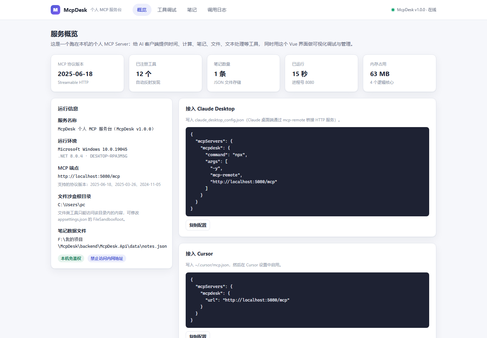
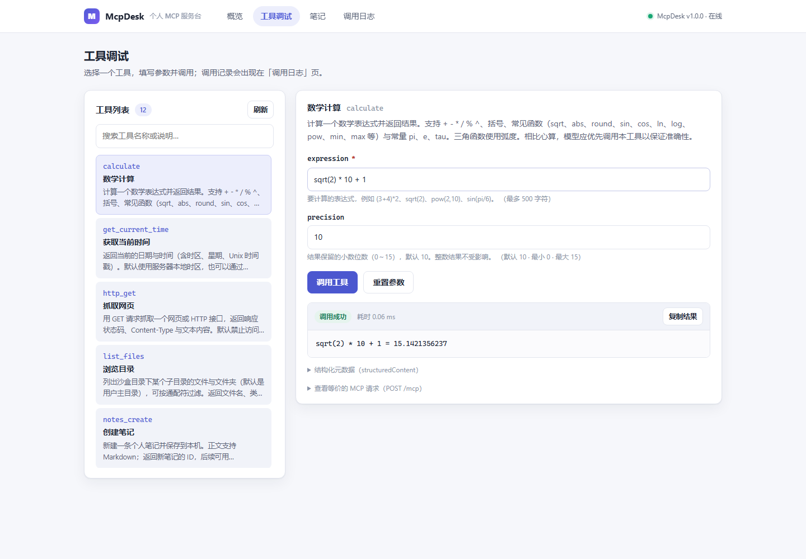

# McpDesk · 个人 MCP 服务台

用 **.NET 8 Web API**（后端）+ **Vue 3 + Vite**（前端）写的个人 MCP Server：
既是给 Claude Desktop / Cursor / VS Code 等 AI 客户端调用的 MCP 服务，
也自带一个可视化管理后台，用来调试工具、管理笔记、查看调用日志。

全部代码都带详细中文注释，适合作为学习 MCP 协议与 ASP.NET Core / Vue 全栈开发的参考项目。





---

## 一、它能做什么

### 1. 作为 MCP Server

在 `POST /mcp` 上实现 **MCP（Model Context Protocol）** 的 Streamable HTTP 传输：

| 能力 | 说明 |
| --- | --- |
| `tools` | 12 个内置工具（计算、时间、笔记、文件、文本、随机数、网页抓取、系统信息） |
| `resources` | 把每条笔记以一个只读资源（`mcpdesk://notes/{id}`）暴露给客户端 |
| `prompts` | 两个预置提示词模板：整理笔记 `note_digest`、今日简报 `daily_brief` |
| `logging` | 接受 `logging/setLevel`，不主动推送日志 |

协议版本：`2025-06-18`（同时兼容 `2025-03-26`、`2024-11-05` 握手）。
实现方式为无状态 JSON-RPC 2.0 over HTTP，支持单条请求与批量数组，
并回写 `Mcp-Session-Id` 响应头。

### 2. 作为管理后台

- **概览**：服务状态、版本、数据路径、接入配置（Claude Desktop / Cursor / VS Code 一键复制）
- **工具调试**：根据工具的 JSON Schema 自动生成参数表单，调用并查看结果与结构化数据
- **笔记**：完整的增删改查，与 AI 共用同一份数据
- **调用日志**：最近 100 条调用的来源、参数、耗时、结果预览，支持自动刷新

---

## 二、技术栈与设计取舍

| 部分 | 选型 | 原因 |
| --- | --- | --- |
| 后端 | ASP.NET Core 8 Minimal Hosting | 跨平台、单文件部署、内置 DI 与配置系统 |
| 协议 | 手写 JSON-RPC 2.0 | **零第三方 NuGet 依赖**，可完全离线还原与构建 |
| 存储 | JSON 文件（`data/notes.json`） | 个人规模足够，便于直接阅读、备份与版本管理 |
| 前端 | Vue 3 `<script setup>` + Vite | 组合式 API 简洁，Vite 构建快、代理方便 |
| 样式 | 手写 CSS | 不引入 UI 库，依赖最少、体积最小 |
| 日志 | 内存环形缓冲 | 不落盘、避免记录敏感参数，重启即清空 |

设计上的几个关键点：

- **工具自动注册**：任何实现 `IMcpTool` 的类都会被反射发现并注入 DI，新增工具无需改任何注册代码。
- **输入 Schema 驱动表单**：工具声明自己的 `inputSchema`，前端据此渲染控件，前后端解耦。
- **统一执行入口**：MCP 端点与 REST 接口都调用同一个 `McpRequestHandler.ExecuteToolAsync`，行为一致。
- **中文错误信息**：所有面向使用者的异常都是中文，前端可以直接展示。

---

## 三、目录结构

```text
McpDesk/
├─ McpDesk.sln                  # 解决方案文件（可直接用 Visual Studio 打开）
├─ README.md
├─ docs/                        # 截图等文档资源
│
├─ backend/McpDesk.Api/
│  ├─ Program.cs                # 启动入口：DI、中间件、端点映射
│  ├─ McpDesk.Api.csproj
│  ├─ appsettings.json          # 运行配置（McpDesk 节点）
│  ├─ appsettings.Development.json
│  ├─ Properties/launchSettings.json
│  │
│  ├─ Mcp/                      # MCP 协议实现
│  │  ├─ McpProtocol.cs         # 协议常量、错误码、服务信息
│  │  ├─ IMcpTool.cs            # 工具接口 + 定义 + 结果模型
│  │  ├─ JsonSchemaBuilder.cs   # 流式构建 inputSchema
│  │  ├─ ToolArgs.cs            # 参数读取辅助 + ToolException
│  │  ├─ McpToolRegistry.cs     # 按名称索引全部工具
│  │  ├─ McpRequestHandler.cs   # 方法分发：initialize / tools / resources / prompts
│  │  ├─ McpEndpoint.cs         # HTTP 层：鉴权、UTF-8 校验、批量、序列化
│  │  └─ Tools/                 # 12 个工具的实现
│  │
│  ├─ Controllers/              # 供 Vue 使用的 REST 接口
│  │  ├─ ToolsController.cs     # 工具列表 / 调用
│  │  ├─ NotesController.cs     # 笔记 CRUD
│  │  ├─ LogsController.cs      # 调用日志
│  │  └─ SystemController.cs    # 运行状态
│  │
│  ├─ Services/
│  │  ├─ AppOptions.cs          # 配置模型
│  │  ├─ NoteStore.cs           # 笔记持久化（锁 + 原子写）
│  │  ├─ CallLogStore.cs        # 内存日志环形缓冲
│  │  └─ FileSandbox.cs         # 文件访问沙盒（路径越界拦截）
│  │
│  ├─ Models/
│  │  ├─ Note.cs
│  │  └─ CallLogEntry.cs
│  │
│  └─ data/                     # 运行时生成：notes.json（已加入 .gitignore）
│
└─ frontend/
   ├─ package.json
   ├─ vite.config.js            # 开发代理 + 构建输出到后端 wwwroot
   ├─ index.html
   └─ src/
      ├─ main.js
      ├─ App.vue                # 顶栏、hash 路由、状态探测
      ├─ api.js                 # 请求封装与错误整理
      ├─ styles.css             # 全局样式
      └─ components/
         ├─ OverviewPanel.vue   # 概览 + 接入配置
         ├─ ToolsPanel.vue      # 工具列表与调用
         ├─ SchemaForm.vue      # 由 JSON Schema 生成表单
         ├─ NotesPanel.vue      # 笔记管理
         └─ LogsPanel.vue       # 调用日志
```

---

## 四、快速开始

### 环境要求

- .NET SDK 8.0 或更高
- Node.js 18+（推荐 20+）与 npm

### 1. 启动后端

```powershell
cd backend/McpDesk.Api
dotnet run
```

看到监听 `http://localhost:5080` 即可。验证：

```powershell
curl http://localhost:5080/health
```

### 2. 开发模式启动前端

另开一个终端：

```powershell
cd frontend
npm install
npm run dev
```

浏览器打开 <http://localhost:5173>。
Vite 会把 `/api`、`/mcp`、`/health` 代理到 5080 端口，不需要处理跨域。

### 3. 生产模式（单进程）

```powershell
cd frontend
npm run build          # 产物输出到 backend/McpDesk.Api/wwwroot

cd ../backend/McpDesk.Api
dotnet run             # 打开 http://localhost:5080 即可看到完整界面
```

也可以用 `dotnet publish -c Release -o out` 发布后运行 `out/McpDesk.Api.exe`。

### 4. 可选：Visual Studio

直接打开 `McpDesk.sln`，把 `McpDesk.Api` 设为启动项目，F5 运行。
（前端仍需单独 `npm run dev`，或先执行 `npm run build`。）

---

## 五、接入 AI 客户端

服务地址统一为 `http://localhost:5080/mcp`。

### Claude Desktop

编辑 `claude_desktop_config.json`（Claude 桌面端通过 `mcp-remote` 桥接 HTTP 服务）：

```json
{
  "mcpServers": {
    "mcpdesk": {
      "command": "npx",
      "args": ["-y", "mcp-remote", "http://localhost:5080/mcp"]
    }
  }
}
```

### Cursor

编辑 `~/.cursor/mcp.json`：

```json
{
  "mcpServers": {
    "mcpdesk": { "url": "http://localhost:5080/mcp" }
  }
}
```

### VS Code（GitHub Copilot）

在工作区创建 `.vscode/mcp.json`：

```json
{
  "servers": {
    "mcpdesk": { "type": "http", "url": "http://localhost:5080/mcp" }
  }
}
```

> 如果配置了 `McpDesk:ApiKey`，客户端还需要附带请求头 `X-Api-Key: <密钥>`。

### 手动验证协议

```powershell
# 1. 握手
curl -X POST http://localhost:5080/mcp -H "Content-Type: application/json" -d "{\"jsonrpc\":\"2.0\",\"id\":1,\"method\":\"initialize\",\"params\":{\"protocolVersion\":\"2025-06-18\",\"capabilities\":{},\"clientInfo\":{\"name\":\"curl\",\"version\":\"1.0\"}}}"

# 2. 列出工具
curl -X POST http://localhost:5080/mcp -H "Content-Type: application/json" -d "{\"jsonrpc\":\"2.0\",\"id\":2,\"method\":\"tools/list\"}"

# 3. 调用计算工具
curl -X POST http://localhost:5080/mcp -H "Content-Type: application/json" -d "{\"jsonrpc\":\"2.0\",\"id\":3,\"method\":\"tools/call\",\"params\":{\"name\":\"calculate\",\"arguments\":{\"expression\":\"sqrt(2)*10\",\"precision\":4}}}"
```

> Windows 控制台里的 curl 可能会用本地代码页发送中文，导致请求体不是合法 UTF-8。
> 服务端会明确返回 `-32700`，此时把请求体写成 UTF-8 文件再用 `--data-binary @file.json` 发送即可。

---

## 六、内置工具一览

| 工具名 | 中文名 | 说明 | 主要参数 |
| --- | --- | --- | --- |
| `calculate` | 数学计算 | 解析并计算数学表达式，支持函数与常量 | `expression`、`precision` |
| `get_current_time` | 获取当前时间 | 日期、时区、星期、Unix 时间戳 | `timezone`、`includeUnix` |
| `http_get` | 抓取网页 | GET 请求文本类网页/接口，默认禁止内网 | `url`、`maxBytes`、`followRedirects` |
| `list_files` | 浏览目录 | 列出沙盒内目录，支持通配符与递归 | `path`、`pattern`、`recursive`、`limit` |
| `read_text_file` | 读取文本文件 | 按行范围读取文本文件，限制 512 KB | `path`、`startLine`、`lineCount` |
| `notes_list` | 列出或检索笔记 | 按关键字/标签检索，可含正文 | `keyword`、`tag`、`limit`、`includeContent` |
| `notes_create` | 创建笔记 | 新建笔记并落盘 | `title`、`content`、`tags` |
| `notes_update` | 修改笔记 | 部分更新标题/正文/标签 | `id`、`title`、`content`、`tags` |
| `notes_delete` | 删除笔记 | 按 ID 删除 | `id` |
| `random_generate` | 生成随机内容 | UUID、密码、区间随机数、掷骰子 | `kind`、`count`、`length` 等 |
| `text_transform` | 文本处理 | Base64/URL 编解码、哈希、JSON 格式化、大小写、统计 | `operation`、`text` |
| `system_info` | 系统信息 | 操作系统、CPU、内存、磁盘、运行时版本 | `includeDrives` |

所有工具的参数说明都在代码的 `InputSchema` 中，前端表单与 AI 看到的是同一份定义。

---

## 七、REST 接口（管理后台使用）

| 方法 | 路径 | 说明 |
| --- | --- | --- |
| GET | `/health` | 健康检查（含工具数量） |
| GET | `/api/system` | 运行状态与配置概览 |
| GET | `/api/tools` | 全部工具定义 |
| GET | `/api/tools/{name}` | 单个工具定义 |
| POST | `/api/tools/{name}/invoke` | 调用工具，请求体即 arguments |
| GET | `/api/notes?keyword=&tag=&limit=` | 查询笔记 |
| GET | `/api/notes/{id}` | 单条笔记 |
| POST | `/api/notes` | 新建笔记 |
| PUT | `/api/notes/{id}` | 部分更新笔记 |
| DELETE | `/api/notes/{id}` | 删除笔记 |
| GET | `/api/logs?limit=` | 最近调用日志 |
| DELETE | `/api/logs` | 清空日志 |
| POST | `/mcp` | MCP 协议端点（JSON-RPC 2.0） |

---

## 八、配置说明

`appsettings.json` 中的 `McpDesk` 节点：

| 配置项 | 默认值 | 说明 |
| --- | --- | --- |
| `ApiKey` | `""` | 非空时 `/mcp` 要求 `X-Api-Key` 请求头一致 |
| `StorageRoot` | `"data"` | 笔记数据目录（相对或绝对路径） |
| `FileSandboxRoot` | `""` | 文件工具可访问的根目录，留空 = 当前用户目录 |
| `MaxFetchBytes` | `1000000` | `http_get` 单次最多读取的字节数 |
| `AllowPrivateNetwork` | `false` | 是否允许 `http_get` 访问本机/内网（SSRF 防护） |
| `MaxLogEntries` | `200` | 内存中保留的调用日志条数（10～5000） |

监听地址默认由 `"Urls": "http://localhost:5080"` 指定，也可用命令行覆盖：

```powershell
dotnet run --urls "http://0.0.0.0:5080"
```

> 绑定到 `0.0.0.0` 之前请务必设置 `ApiKey`；管理接口 `/api` 本身不带鉴权。

---

## 九、安全说明

这是本项目刻意做的几件事，也是个人 MCP 服务容易被忽略的风险点：

1. **文件沙盒**：`list_files` / `read_text_file` 的路径统一经过 `FileSandbox.Resolve`，
   任何越出根目录的路径（包括 `..\..\Windows`）都会被拒绝。
2. **扩展名白名单**：只读取文本类文件，避免把二进制读成乱码或泄露敏感二进制内容。
3. **SSRF 防护**：`http_get` 默认拒绝 `localhost`、`127.0.0.1`、`10.x`、`172.16-31.x`、
   `192.168.x`、链路本地等地址，需要时通过配置显式开启。
4. **响应体上限**：网页抓取最多读取 `MaxFetchBytes`，避免内存被撑爆。
5. **正文校验**：`/mcp` 先验证请求体是合法 UTF-8 且不超过 4 MB，再解析 JSON。
6. **原子写盘**：笔记文件先写临时文件再替换，断电不会留下半截 JSON；
   文件损坏时自动备份为 `.broken-时间戳`，不会静默清空数据。

### 仍然需要注意

- 管理接口 `/api/*` 没有鉴权，请只在本机访问，不要直接暴露到公网。
- MCP 的 `ApiKey` 是简单的请求头比对，定位是「内网防护」而非强认证。
- 工具调用的参数会发给 AI，请不要把密码等敏感信息写进笔记或参数里。

---

## 十、如何新增一个工具

1. 在 `backend/McpDesk.Api/Mcp/Tools/` 新建类，实现 `IMcpTool`；
2. 在 `Definition` 中声明名称、说明与 `InputSchema`；
3. 在 `InvokeAsync` 中用 `ToolArgs` 读取参数，返回 `McpToolResult.Ok(...)`；
4. 参数错误抛 `ToolException`（中文消息），会被统一转成 `isError` 结果。

示例骨架：

```csharp
public sealed class HelloTool : IMcpTool
{
    public McpToolDefinition Definition { get; } = new()
    {
        Name = "hello",
        Title = "打招呼",
        Description = "返回一句问候语。",
        InputSchema = new JsonSchemaBuilder()
            .AddString("name", "对方的名字。", required: true, maxLength: 50)
            .Build(),
    };

    public Task<McpToolResult> InvokeAsync(JsonObject arguments, CancellationToken cancellationToken)
    {
        var name = new ToolArgs(arguments).RequiredString("name", "名字");
        return Task.FromResult(McpToolResult.Ok($"你好，{name}！"));
    }
}
```

无需注册——重启后工具会自动出现在 `tools/list` 与管理后台中。

---

## 十一、常见问题

**Q：端口被占用怎么办？**
修改 `appsettings.json` 的 `Urls`，或运行时用 `--urls http://localhost:5090`。
注意同时修改 `frontend/vite.config.js` 中的代理目标。

**Q：前端页面打不开 / 一直显示「后端未连接」？**
先确认 `dotnet run` 已经启动且 `http://localhost:5080/health` 可访问。
开发模式访问 5173，生产模式访问 5080。

**Q：`npm install` 很慢？**
项目没有锁死私有源，可临时指定镜像：
`npm install --registry=https://registry.npmmirror.com`。

**Q：笔记数据在哪里？**
默认 `backend/McpDesk.Api/data/notes.json`，路径可在概览页或 `/api/system` 查看。

**Q：为什么日志重启后就没了？**
日志是内存环形缓冲，刻意不落盘：既避免长期占用磁盘，也避免把调用参数（可能包含隐私）持久化。

**Q：为什么不用数据库？**
个人笔记规模在数千条以内，JSON 文件足以支撑，同时更便于备份与迁移。
如果需要多用户/并发/检索，可以替换 `NoteStore` 的实现而不影响上层。

---

## 十二、学习路线建议

如果想借这个项目学习 MCP，推荐按以下顺序阅读代码：

1. `Mcp/McpProtocol.cs` —— 协议版本与错误码
2. `Mcp/IMcpTool.cs` —— 一个工具长什么样
3. `Mcp/Tools/CalculateTool.cs` —— 最完整的工具实现（含表达式解析器）
4. `Mcp/McpRequestHandler.cs` —— 请求如何分发
5. `Mcp/McpEndpoint.cs` —— JSON-RPC 如何映射到 HTTP
6. `frontend/src/components/SchemaForm.vue` —— Schema 如何驱动 UI
7. `Services/FileSandbox.cs` 与 `Mcp/Tools/HttpGetTool.cs` —— 安全边界的写法

---

## 许可

个人学习项目，可自由修改与使用。
